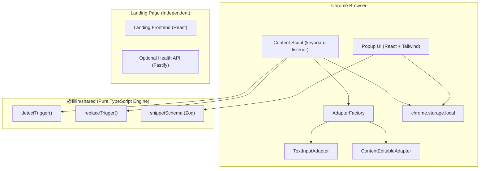

#  Fillin

> **Fill in your own blanks.**  
> Create instant shortcuts for anything you type repeatedly. Privacy-first, local-first, blazing fast.


---

## 📥 Download & Install

**👉 [Download the Fillin Extension Here](https://fillin-eta.vercel.app/)**

Follow the simple 3-step guide on the website to install the extension directly into Chrome!

The website's **Color theme** control offers **System**, **Light**, and **Dark** modes, including the installation page. System follows your device setting; an explicit choice is remembered locally and shared between open website tabs. The switch also works for the current visit when browser storage is blocked.

---

##  Overview

**Fillin** is a privacy-focused Chrome Extension that expands custom text snippets natively anywhere in your browser using the `Ctrl + Space` hotkey.

Whether you're typing your email (`/email`), a canned customer support response (`/thanks`), or a multi-line code snippet (`/boilerplate`), Fillin replaces your trigger in milliseconds. It operates **100% locally on your machine**—requiring no user accounts, no cloud sync, and no third-party servers to expand text.

---

##  Key Features

-  **Instant Snippet Expansion**: Type your snippet trigger (e.g. `/email`) and hit `Ctrl + Space` to expand it inline.
-  **In-Page Command Palette**: Press `Ctrl + Shift + K` (or `Cmd + Shift + K` / `Cmd + /`) to summon a Raycast-style floating palette over any webpage, search across your entire snippet library, and insert with `Enter`.
-  **Local Gamification (Keystrokes & Time Saved)**: Real-time counter displayed in the popup tracking total keystrokes and minutes saved—calculated and stored 100% locally.
-  **Tags & Category Organization**: Categorize snippets with `#tags` (e.g., `#email`, `#work`, `#dev`) and filter your library with 1 click.
-  **1-Click JSON Portability & Starter Pack**: Instant local export and import for hassle-free backup, plus a pre-bundled starter pack with popular productivity shortcuts.
-  **Universal DOM & Canvas Adapters**:
  - **Standard Inputs & Textareas**: Full support for `<input>` and `<textarea>` elements.
  - **React-Controlled Fields**: Bypasses React's internal value setter override (`Object.getOwnPropertyDescriptor`) so synthetic events bubble naturally.
  - **Rich-Text & ContentEditable Editors**: Native support for complex wrappers like Notion, Gmail, and rich text editors (`isContentEditable`).
  - **Web Components & Shadow DOM**: Pierces Shadow DOM boundaries (e.g., YouTube search bar) and dispatches composed input/change events across shadow boundaries.
  - **Google Docs Canvas Adapter**: Dedicated adapter with an ephemeral, privacy-first keystroke buffer and clipboard bridge tailored for Google Docs' custom HTML5 canvas rendering engine.
  - **Restricted Inputs**: Automatically handles cursor position calculation for HTML5 input types (`search`, `url`, `tel`).
-  **Site Blacklist & 1-Click Pause Mode**: Instantly disable Fillin on sensitive websites (banking portals, internal tools, code sandboxes) with a single click in the popup, or manage custom blacklisted domains with automatic subdomain matching (`secure.chase.com` matches `chase.com`).
-  **Snippet Duplicate Warning & Conflict Resolution**: Real-time visual conflict detection in the snippet editor that prevents exact duplicate triggers and warns on prefix overlaps (e.g., `/e` vs `/email`), providing clean clickable suggestions (`/email2`, `/myemail`).
-  **Zero Data Collection**: Operates strictly on `chrome.storage.local`. No typing data or keystrokes ever leave your browser.
-  **Minimal Popup UI**: Sleek, modern monochromatic extension popup to create, edit, search, and manage shortcuts effortlessly.
-  **Decoupled Monorepo Architecture**: Clean separation between the core shared engine, the extension, and the marketing landing app.

---

##  Monorepo Architecture

Fillin is structured as a [Turborepo](https://turbo.build/) monorepo powered by `pnpm` workspaces:

```
Fillin/
├── apps/
│   ├── extension/          # Chrome Extension (React 18, Vite, Manifest V3, TailwindCSS)
│   └── landing/
│       ├── frontend/       # Marketing Landing Page (React 18, Vite, TailwindCSS)
│       └── backend/        # Optional, independently deployable health API (Node.js, Fastify)
├── packages/
│   ├── shared/             # Pure, framework-agnostic core logic & TypeScript models
│   └── config/             # Shared TypeScript and ESLint configurations
├── AGENTS.md               # Monorepo architectural rules & invariants
└── ARCHITECTURE.md         # In-depth technical architecture documentation
```

### System Component Diagram



---

##  How It Works Under the Hood

### 1. Trigger Detection Engine ([`packages/shared/src/engine/detector.ts`](file:///Users/samprati/Desktop/Projects/Fillin/Fillin/packages/shared/src/engine/detector.ts))
When `Ctrl + Space` is pressed, Fillin extracts the text preceding the cursor and scans for triggers starting with `/`:
- **Word Boundary Verification**: Ensures the trigger is preceded by whitespace, line start, or punctuation (`[\s.,;:!?()[\]{}"'<>]`), preventing accidental triggers inside URLs (e.g. `https://github.com/email`).
- **Registered Match**: Checks candidate triggers against locally cached shortcuts.

### 2. Universal DOM Adapters ([`apps/extension/src/content/adapters`](file:///Users/samprati/Desktop/Projects/Fillin/Fillin/apps/extension/src/content/adapters))
- **`TextInputAdapter`**: Reads `selectionStart`/`selectionEnd` and mutates the element's value using the native prototype setter (`HTMLInputElement.prototype.value`), dispatching a bubbling `input` event to notify React/Vue/Angular state handlers.
- **`ContentEditableAdapter`**: Interacts directly with `window.getSelection()` and DOM `Text` nodes, updating `node.textContent` and setting `Range` start/end points to maintain precise cursor position.

### 3. Local Storage Persistence ([`apps/extension/src/storage`](file:///Users/samprati/Desktop/Projects/Fillin/Fillin/apps/extension/src/storage))
Uses a repository pattern ([`SnippetRepository`](file:///Users/samprati/Desktop/Projects/Fillin/Fillin/apps/extension/src/storage/SnippetRepository.ts)) with implementations for Chrome Storage API (`chrome.storage.local`), Web `localStorage`, and an `InMemoryRepository` for unit tests.

### 4. Site Blacklist & Privacy Shield ([`apps/extension/src/services/BlacklistService.ts`](file:///Users/samprati/Desktop/Projects/Fillin/Fillin/apps/extension/src/services/BlacklistService.ts))
Provides instant 1-click site pausing and domain blacklisting:
- **Subdomain Matching**: Automatically protects subdomains (e.g. blocking `chase.com` protects `secure.chase.com` and `login.chase.com`).
- **Zero Ingestion**: When paused, the content script stays completely silent, bypassing all keyboard capture and shortcut handling.

### 5. Conflict Resolution & Duplicate Guard ([`apps/extension/src/components/SnippetForm.tsx`](file:///Users/samprati/Desktop/Projects/Fillin/Fillin/apps/extension/src/components/SnippetForm.tsx))
Real-time trigger conflict evaluation as you type:
- **Exact Duplicates**: Blocks creation and suggests numbered/prefixed alternatives (e.g., `/email2`, `/myemail`).
- **Prefix Overlaps**: Flags trigger ambiguities (e.g., `/e` vs `/email`) to ensure longest-match expansion predictability.

---

##  Developer Setup & Usage Guide

### Prerequisites

- **Node.js**: Node 22 LTS, version `22.12.0` or later (`.node-version` selects Node 22).
- **pnpm**: Exactly `12.9.1`, pinned in `package.json`. Use Corepack to select the project version.

---

### Step 1: Clone & Install Dependencies

```bash
git clone https://github.com/vishalsingh-data/Fillin.git
cd Fillin
corepack enable
pnpm --version # Must print 12.9.1
pnpm install --frozen-lockfile
```

If an existing `pnpm` command overrides the Corepack shim, use `corepack pnpm` in place of `pnpm` (for example, `corepack pnpm install --frozen-lockfile`). Do not use a different pnpm major with the existing installation. Scripts now report outdated dependencies instead of automatically reinstalling them; run the install command explicitly after dependency changes.

---

### Step 2: Build the Chrome Extension

To create a production build of the Chrome extension:

```bash
pnpm exec turbo run build --filter=@fillin/extension
```

This compiles the extension assets into `apps/extension/dist`.
The build first compiles the shared package to JavaScript and TypeScript declarations in `packages/shared/dist`.
It also creates `apps/extension/build/fillin-extension.zip` without changing the landing website.

To update the website's extension download, run this separate release command from the repository root:

```bash
pnpm release:extension
```

This builds and packages the extension, stages the website ZIP and release notes, builds the landing frontend, and verifies the download's version, SHA-256, and file contents. It prepares the current release for deployment without publishing it.

For a new version, run `pnpm release:version <version>`, refresh dependencies with `pnpm install --frozen-lockfile`, and add its notes to [CHANGELOG.md](CHANGELOG.md) before preparing the release. See [the release guide](docs/development/releases.md) for the complete process and checksum verification.

---

### Step 3: Load Extension in Google Chrome

1. Open **Google Chrome** and navigate to `chrome://extensions/`.
2. Enable **Developer mode** using the toggle in the top-right corner.
3. Click **Load unpacked** in the top-left menu.
4. Select the build directory: `<path-to-repo>/Fillin/apps/extension/dist`.
5.  **Fillin is ready!**
   - Click the extension icon in Chrome. The first-use guide helps you save one shortcut, try it in a practice field with `Ctrl + Space` (Control on Mac too), and export a JSON backup.
   - You can skip the guide. If you close it after saving your first shortcut, it resumes at practice when you reopen Fillin. Existing libraries open as usual.
   - Use **Export snippets** at the top of the library for later backups, or **Import snippets** to restore a JSON file. Practice does not add to usage statistics.
   - On a website, type your saved trigger in a text box and press `Ctrl + Space`.

---

### Step 4: Development Commands

You can run individual applications or the full monorepo in development mode:

| Task | Command | Description |
| :--- | :--- | :--- |
| **Full Monorepo** | `pnpm dev` | Runs backend, landing page, and extension simultaneously |
| **Extension Popup UI** | `pnpm exec turbo run dev --filter=@fillin/extension` | Builds shared code, then starts Vite for popup UI development |
| **Landing Frontend** | `pnpm exec turbo run dev --filter=@fillin/landing-frontend` | Builds shared code, then starts the landing page (`http://localhost:5173`) |
| **Landing Backend (optional)** | `pnpm --filter @fillin/landing-backend dev` | Starts the standalone health API (`http://localhost:3000/health`) |

---

### Step 5: Testing & Quality Checks

Run tests and typechecks across all packages in the workspace:

```bash
# Run unit tests across all packages
pnpm test

# Run TypeScript type-checking across all packages
pnpm typecheck

# Format code with Prettier
pnpm format
```

GitHub Actions runs typechecks, tests, and production builds for every pull request and pushes to `main`. The workflow installs the pinned pnpm version and uses `pnpm install --frozen-lockfile` so dependency changes must include an updated lockfile.
It also runs `pnpm verify:release` to reject stale or mismatched website downloads.

It also runs real-browser extension checks in Chromium. To install the browser and run the same checks locally:

```bash
corepack pnpm --filter @fillin/extension test:e2e:install
corepack pnpm test:e2e
```

These load the built extension in an isolated profile and exercise typing, cursor placement, password protection, rich-text insertion, and simultaneous extension windows. See [the development guide](docs/development/README.md) for details.

After a production build, run `corepack pnpm --filter @fillin/landing-frontend test:e2e` for the website theme checks. They cover system changes, saved preferences, startup without a light flash, blocked storage, multiple tabs, text contrast, demos, and both pages at phone, tablet, and desktop widths. GitHub Actions runs these checks too.

---

##  Privacy & Security Model

Fillin is built on a strict **privacy-first design**:

- **Zero Remote Analytics**: Keystroke detection and expansion occur entirely inside your browser tab's content script sandbox.
- **Chrome Permissions**: `"storage"` saves snippets, settings, and statistics locally. `"clipboardWrite"` supports the Google Docs clipboard fallback. The content script runs on matching websites (`<all_urls>`, including frames) to expand text. No `"tabs"`, `"cookies"`, or `"webRequest"` permissions are requested.
- **Decoupled Architecture**: The extension codebase makes zero HTTP/REST calls to any backend server.

---

##  Architectural Invariants

Developers contributing to Fillin must adhere to the rules defined in [`AGENTS.md`](file:///Users/samprati/Desktop/Projects/Fillin/Fillin/AGENTS.md) and [`ARCHITECTURE.md`](file:///Users/samprati/Desktop/Projects/Fillin/Fillin/ARCHITECTURE.md):

1. **Shared Package Discipline**: `packages/shared` must remain framework-agnostic. No Chrome APIs, DOM objects (`window`, `document`), React components, or server code inside `@fillin/shared`.
2. **App Decoupling**: Extension must remain independent from the landing page and backend.
3. **Security**: Password fields (`<input type="password">`) are strictly ignored by trigger detection.

---

##  Frequently Asked Questions (FAQ)

**Where does Fillin work?**  
Fillin natively supports text inputs, forms, and rich-text editors everywhere across the web—including **Google Docs**, **YouTube**, **Gmail**, **Notion**, **GitHub**, and **Jira**. For maximum privacy and zero friction, it intentionally stays out of your browser's native URL address bar and internal browser settings pages.

**Is my data secure?**  
Absolutely. Fillin has zero remote analytics and no backend database. Your snippets are stored 100% locally in your browser, and keystrokes are processed entirely within the tab's secure sandbox.

**Is Fillin free?**  
Yes, Fillin is completely free and open-source. There are no premium tiers, no locked features, and no tracking.

---
##  Contributing

Contributions are welcome! Please read [CONTRIBUTING.md](CONTRIBUTING.md) and [docs/development/README.md](docs/development/README.md) before submitting pull requests.

---

##  License

Distributed under the [GNU General Public License v3.0 (GPL-3.0)](LICENSE).
